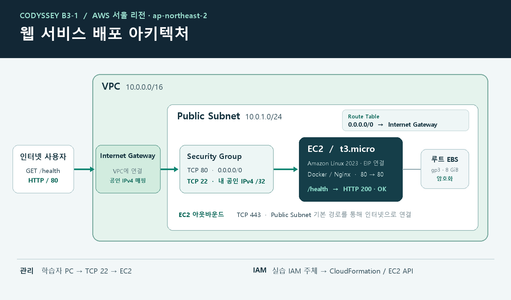

# B3-1 · 내가 만든 웹사이트를 인터넷에 올려 누구나 쓰게 하기

AWS 서울 리전(`ap-northeast-2`)에 VPC를 만들고, Public Subnet의 EC2 한 대에서 Nginx로 웹페이지를 제공하는 실습이다. 외부 접속 검증은 **B 방식**을 선택했다. EC2 밖의 PC에서 `GET /health`를 호출해 HTTP `200`과 본문 `OK`를 확인한다.

| 제출 항목 | 파일 또는 상태 |
|---|---|
| 아키텍처 다이어그램 | [docs/architecture.png](docs/architecture.png) |
| 외부 접속 URL과 스크린샷 | AWS 배포 대기. 배포 후 출력되는 `HealthUrl`과 `docs/evidence/01-external-health.png`를 이 행에 추가한다. |
| 트러블슈팅 | [docs/troubleshooting.md](docs/troubleshooting.md) · 로컬 Nginx에서 404 재현과 수정 후 200 확인 |
| 리소스 정리 | [docs/cleanup-checklist.md](docs/cleanup-checklist.md) · AWS 배포 후 삭제 결과 기록 |
| 평가 대비 | [docs/evaluation.md](docs/evaluation.md) |



## 1. 준비

1. [AWS CLI v2](https://docs.aws.amazon.com/cli/latest/userguide/getting-started-install.html), Windows PowerShell 5.1 이상, `ssh`, `ssh-keygen`, `curl.exe`를 사용한다.
2. 계정 담당자가 [실습용 정책](iam/learner-policy.json)을 고객 관리형 정책으로 등록하고, 전용 IAM 사용자 또는 Role 하나에 연결한다. 같은 주체로 콘솔과 CLI를 사용한다. CLI 프로필 이름은 아래에서 `b3-1`로 가정한다. AWS IAM Identity Center를 사용하면 `aws configure sso --profile b3-1`과 `aws sso login --profile b3-1`로 접속한다. IAM 사용자를 쓰는 경우 담당자가 제공한 인증 방법으로 `b3-1` 프로필을 설정한다. `aws sts get-caller-identity --profile b3-1 --region ap-northeast-2`로 주체를 확인한다.
3. Billing에서 Free Tier 플랜, 남은 크레딧, EC2·EBS·공인 IPv4 사용량을 확인한 뒤 실습을 시작한다. `t3.micro`와 `gp3`만으로 무료 여부가 결정되지는 않는다. Elastic IP도 연결 여부와 관계없이 공인 IPv4 사용량에 포함된다. [EC2 Free Tier](https://docs.aws.amazon.com/AWSEC2/latest/UserGuide/ec2-free-tier-usage.html) · [VPC 요금](https://aws.amazon.com/vpc/pricing/)
4. 실습용 SSH 키 한 쌍을 만든다. 기존 키가 있다면 같은 명령으로 덮어쓰지 않고 재사용한다. 개인 키는 PC에 보관한다. AWS에는 `.pub` 공개 키만 등록한다.

```powershell
$key = Join-Path $env:USERPROFILE '.ssh\b3-1-ssh'
if (-not (Test-Path -LiteralPath $key)) {
    ssh-keygen -t ed25519 -f $key -C 'codyssey-b3-1'
}
```

## 2. 배포

PowerShell을 Git 저장소 폴더에서 연다. `$myIPv4`에는 SSH를 시도할 PC의 공인 IPv4를 입력한다. AWS EC2 보안 그룹의 **내 IP** 표시값에서 확인할 수 있다. `-FreeTierChecked`는 위 Billing 단계에서 사용량을 확인한 후 지정한다.

```powershell
$myIPv4 = Read-Host 'SSH에 사용할 공인 IPv4'
.\mission.ps1 -Action Deploy -Profile b3-1 -AdminCidr "$myIPv4/32" `
    -PublicKeyPath "$key.pub" -FreeTierChecked
```

- 배포 스크립트가 `infra/template.yml`에 웹페이지와 초기 부팅 스크립트를 넣고 CloudFormation 스택 `codyssey-b3-1`을 생성한다. 스택이 VPC, Public Subnet, IGW, 기본 경로, 보안 그룹, EC2, EIP를 관리한다. EC2는 `t3.micro`, Amazon Linux 2023, 암호화된 `gp3` 8 GiB를 사용한다. EC2가 종료되면 루트 EBS도 함께 삭제된다.
- 스택이 완료된 뒤 EC2의 초기 부팅 스크립트가 Docker와 Nginx 컨테이너를 준비한다. 공인 주소는 EIP 하나를 연결한다. EC2 자동 공인 IP는 꺼 둔다.
- CloudFormation 생성에 실패하면 콘솔 **Stacks → Events**에서 첫 `CREATE_FAILED`의 리소스와 이유를 확인한다. 재시도 전에 `Cleanup`으로 실패한 스택을 정리한다. 현재 배포는 한 계정의 서울 리전에 같은 이름의 실습 스택 하나를 사용한다.

## 3. 검증 및 증빙

```powershell
.\mission.ps1 -Action Verify -Profile b3-1 -PrivateKeyPath $key
```

1. `Verify` 출력에서 기본 경로 `0.0.0.0/0 → igw-…`, HTTP 80 전체 허용, SSH 22 `/32` 제한을 확인한다.
2. 로컬 PowerShell의 `GET http://…/health`, `HTTP/1.1 200 OK`, 본문 `OK`가 모두 보이도록 캡처한다. `docs/evidence` 폴더를 만들고 `01-external-health.png`로 저장한 뒤 위 표에 **실제 URL과 이미지 링크**를 넣는다. URL은 실습 당시 접속 기록으로 남긴다.
3. SSH에 처음 접속하면 인스턴스 콘솔 로그의 SSH 호스트 키 지문과 비교한 후 확인한다. `docker ps`의 컨테이너 Up, `localhost: 200`, `outbound: 200`이 보이는 화면을 `docs/evidence/02-ssh-docker.png`로 저장한다. 평가 자료에는 계정 번호, 개인 IP, 키 경로가 불필요하게 노출되지 않도록 한다.
4. 컨테이너 이미지는 [공식 Nginx `docker.io/library/nginx:stable-alpine`](https://hub.docker.com/_/nginx)이다. EC2 부팅 시 `docker run -d --restart unless-stopped --publish 80:80`으로 실행하며, EC2 TCP 80을 컨테이너 TCP 80에 연결한다. 웹페이지와 Nginx 설정은 읽기 전용으로 연결한다. 외부 응답과 `docker ps`의 스크린샷 두 장이 Docker 보너스 증빙에도 해당한다.

## 4. 정리

```powershell
.\mission.ps1 -Action Cleanup -Profile b3-1
```

출력의 `StackStatus: DELETE_COMPLETE`, `Passed: true`, `Remaining` 전 항목이 비어 있는지 확인한다. 로컬 `.mission/<계정 번호>/cleanup.json`의 결과를 참고해 [정리 체크리스트](docs/cleanup-checklist.md)를 채운다. AWS에서 EIP를 해제하면 실습 URL은 더 이상 이 서비스로 연결되지 않는다. 접속 증빙을 먼저 저장한다.
